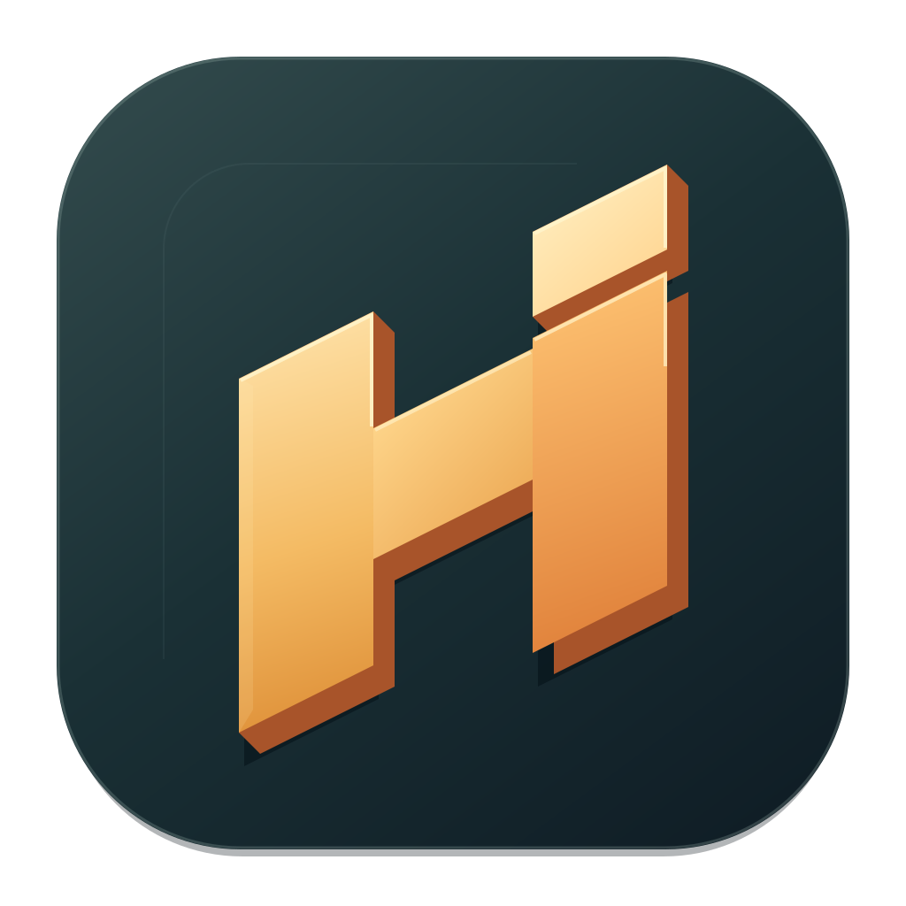

# HeroGame Art Studio

[中文](README.md) | **English**



A local pixel-asset workshop with a macOS desktop client and a source-run web UI. Use your own Vertex AI Express / Google AI Studio API Key to make fighting-game sprite sheets and desk-pet portraits (prompt → generate → split → commit or export). **This repo does not include the fighting game.**

Public repo: <https://github.com/jayson-sheyue/herogame-studio>  
Fighting-game repo: <https://github.com/jayson-sheyue/herogame>

Auth is **API Key only** — no Google Cloud CLI, GCP project ID, or ADC login. Keys stay in the local service session by default; only “Remember key” writes them to the system credential store. Ordinary settings files, projects, browser storage, and export packs never contain the API Key.

**UI languages:** Chinese (default) and English. Switch under **API Key settings → Interface language**. LLM system prompts follow the UI language. Voice-line *content* language remains a separate TTS setting.

---

## macOS client (beta)

Download from the [GitHub pre-release page](https://github.com/jayson-sheyue/herogame-studio/releases/tag/v0.1.0-beta.6). Apple Silicon (M-series) / macOS 15+: open `HeroGameStudio-0.1.0-beta.6-macOS-arm64.dmg`, drag **Art Studio.app** into **Applications**, then launch. Python, dependencies, and the local service are bundled — no Python, Node, or gcloud install, and no terminal left open. Pick a product line and project folder, then enter your key in **API Key settings**. Switch **Interface language** there when you want English.

The client uses native macOS windows plus folder/save dialogs. Closing the window quits; busy tasks or unsaved edits are confirmed first. Cancelled downloads do not show as saved. Quitting stops only the service this app started.

- Projects and exports stay in the folder you chose (same layout as the web workflow).
- Project list and ordinary settings: `~/Library/Application Support/HeroGameStudio/`.
- Keys are session-only unless remembered (macOS Keychain). Bundle ID and settings paths stay stable across upgrades.
- Manual upgrade: finish tasks, quit cleanly, replace the app. Keep the Application Support directory and project folders.

This is a pre-release with ad-hoc integrity signing only — **not Developer ID signed or notarized**. Gatekeeper may block network downloads. See [macOS desktop notes](desktop/README.md). This repository is licensed under [MIT](LICENSE).

## Run from source (web)

### Requirements

| Dependency | Notes |
|---|---|
| OS | macOS, Windows, or Linux |
| Python | **3.11+** (`python3 --version`) |
| pip | Bundled with Python |
| API Key | Your Express or AI Studio key, with model quota |
| Browser | Chrome / Edge / Firefox |
| Network | Vertex / Gemini endpoints for generation |

Python packages: see `studio/requirements.txt`. Usage is billed to your key.

---

## 1. Get your API Key

- **Vertex AI Express**: [Vertex AI Studio API Keys](https://console.cloud.google.com/vertex-ai/studio/settings/api-keys). Keys starting with `AQ.` call Express global endpoints without project/region.
- **Google AI Studio**: [AI Studio API Keys](https://aistudio.google.com/apikey). Keys starting with `AI…` (and newer formats) work when AI Studio is selected.

Prefix auto-detect is only a hint (`AQ.` → Express, otherwise AI Studio). Pick the provider manually when detection is wrong. Each product line remembers its own provider, models, and key.

Connection checks call `countTokens` only — they do not generate images or audio. Real generation may incur charges.

---

## 2. Clone and start

```bash
git clone https://github.com/jayson-sheyue/herogame-studio.git
cd herogame-studio/studio

python3 -m venv .venv
source .venv/bin/activate          # Windows: .venv\Scripts\activate
python3 -m pip install -U pip
python3 -m pip install -r requirements.txt
python3 launch.py
```

When ready, the browser opens **http://127.0.0.1:8787**.

On macOS after the first venv install, you can double-click repo-root `start.command` (prefers `studio/.venv`). Do **not** open `studio/static/index.html` via `file://`.

In **API Key settings**: choose provider, paste the key, set model IDs, then **Save** or **Test connection and save**. Leave the key blank to keep an existing one; **Clear key** removes the current product line’s session/remembered key.

Optional env vars: `STUDIO_API_KEY`, `STUDIO_API_PROVIDER`, `STUDIO_TEXT_MODEL`, `STUDIO_IMAGE_MODEL`.

Official references (verified with `google-genai` 2.23.0, `keyring` 25.7.0): [Express overview](https://docs.cloud.google.com/gemini-enterprise-agent-platform/models/start/express-mode/overview), [Express REST](https://docs.cloud.google.com/gemini-enterprise-agent-platform/reference/express-mode/api-reference), [Gemini API Key](https://ai.google.dev/gemini-api/docs/api-key), [speech generation](https://ai.google.dev/gemini-api/docs/generate-content/speech-generation), [model deprecations](https://ai.google.dev/gemini-api/docs/deprecations), [keyring](https://keyring.readthedocs.io/en/stable/).

---

## 3. Create a content project (not this repo)

1. Choose product line **Fighting-game assets**.
2. **New project** → pick an **empty folder** (e.g. `~/Documents/HeroPacks`). Do not use the cloned `herogame-studio` tree.
3. Folders that contain `game/serve.py` are rejected.

```text
HeroPacks/
  herogame.json
  assets/studio/     # drafts — do not share
  assets/game/       # committed assets
```

---

## 4. Make sprite sheets

Do not skip the order:

1. **Style lock** → prompt → generate → commit (one per project; frozen after commit).
2. **Stage** (optional) → description + keywords + terrain → generate → commit. No characters or text.
3. **Hero** → look / gear / kit → commit **turnaround** first → other strips → split/preview → commit.
4. Enable cyan-key removal for sprites; stages do not need it.

Split is preview-only; re-split without regenerating.

---

## 5. Export to the fighting game

Commit writes only the content project — it does **not** hot-reload a running game.

1. **Export this hero pack** or **Export this stage pack** (`.hgpk.zip`).
2. Import in the fighting-game repo:

```bash
cd herogame/game
python3 import_pack.py ~/Downloads/some-hero.hgpk.zip
```

Do not commit `settings.json`, `projects.json`, draft PNGs, or `.venv`.

---

## 6. Desk-pet portraits

Choose **Desk-pet / portrait assets**, use a separate project, lock style, then create a portrait with an action list. Commit turnaround first, then other actions. **Cyan-key export** writes transparent PNGs under `assets/studio/exports/portraits/<id>/<action>/` — not into the fighting-game tree.

Autosave keeps prompts and briefs; failed saves block generate/split/export. Task panel reports complete / partial / failed for batch export.

## 7. Project switching and limits

One local service process and one active project. Line/project switches are blocked while project jobs run. Stale tabs are rejected after a switch. Refresh all studio tabs after updating code. Back up whole project folders regularly. Do not run multiple workers against the same project.

---

## Offline checks (no paid API calls)

```bash
python3 -m pip install -r studio/requirements-dev.txt
python3 studio/scripts/check.py
```

Needs Node.js 18+ for the browser-script tests. Normal studio use does not need Node.js.

---

## Do not commit

| Path | Why |
|---|---|
| `studio/settings.json`, `settings.*.json` | Local service/model prefs |
| `studio/projects.json` | Local folder paths |
| `.venv/`, `__pycache__/` | Environment |
| Any content PNGs / project folders | Content is not this tool repo |

---

## FAQ

**Auth test fails** — Check provider, API restrictions, billing, and model access; pick the correct provider in settings. ADC / gcloud login is not used.

**403 / empty image** — Key lacks the model or quota. Verify provider and model IDs.

**No project open** — Create or open an empty content folder first.

**Split cannot see a 2×2 grid** — Turnaround is a single row of four frames; update to the latest code and re-split.
